# Aluminium — User Manual

**Aluminium** is a collection of VCV Rack / Cardinal modules to get the most out of your MIDI controllers:
- Split your MIDI keyboard in two, choosing mono or poly for each half.
- Use your MIDI pads or keyboard keys as triggers, gates or latches.
- Take advantage of your MIDI pads' velocity, and even their aftertouch, which is often polyphonic.
- See your MIDI controllers' faders and buttons on screen, and keep using them even when the controller isn't connected.

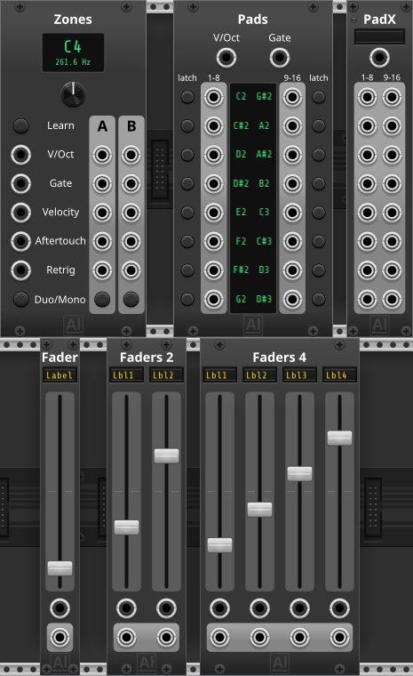

| Module                 | What it does                                                                    |
|-------------------------|----------------------------------------------------------------------------------|
| [Zones](#zones)         | Splits one polyphonic MIDI-CV stream into two note-range zones, each poly or mono |
| [Pads](#pads)           | 16 gate outputs, one per learned note, from a poly V/OCT + GATE cable            |
| [PadX](#padx)           | Pads expander: mirrors its note mapping onto a freely-labeled poly lane |
| [Fader / Faders2 / Faders4](#fader-faders2-and-faders4) | 1, 2 or 4 labeled faders whose CV input moves the slider itself — last mover wins |
| [Buttons](#buttons)     | 2 labeled lit buttons, each pressed by its own panel button or gate/trigger input |

## Table of Contents

- [Panel themes](#panel-themes)
- [Right-click menu](#right-click-menu)
- [Shared conventions](#shared-conventions)
- [Zones](#zones)
  - [Duo mode (Subsequent 37 style)](#duo-mode-subsequent-37-style)
  - [Example patch: split bass/chord synth](#example-patch-split-basschord-synth)
- [Pads](#pads)
- [PadX](#padx)
- [Fader, Faders2 and Faders4](#fader-faders2-and-faders4)
  - [Context menus](#context-menus)
- [Buttons](#buttons)
- [Building and testing](#building-and-testing)
- [AI disclosure](#ai-disclosure)

## Panel themes

Every Aluminium panel follows one shared **Follow Rack / Light / Dark** setting (see [Right-click menu](#right-click-menu) below), independent of Rack's own "Dark panels" preference. Unlike a per-module theme, this one is shared pack-wide — there's only ever one Aluminium theme active at a time, and it applies to every Aluminium module.

### Light

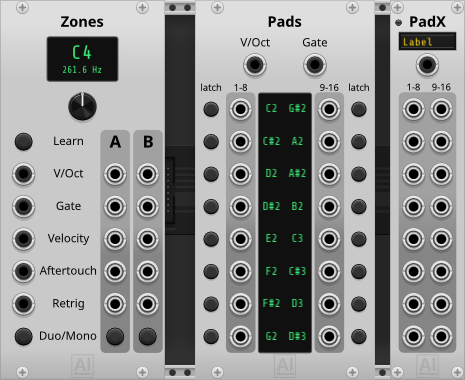

### Dark


## Right-click menu

Right-click any Aluminium module to open its context menu. One entry is identical across all 7 modules:

- **Aluminium theme** — a submenu to switch between *Follow Rack*, *Light*, and *Dark*. Because this setting is shared pack-wide (see [Panel themes](#panel-themes) above), changing it from **any** Aluminium module's menu re-themes **every** Aluminium module currently in the patch, in one step — there's no separate "apply to all" action to trigger, it always applies to the whole pack, immediately.

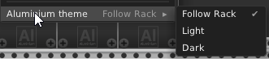

Zones adds two more entries of its own (documented under [Zones](#zones)), and Pads adds three more (documented under [Pads](#pads)). Fader adds four more; Faders2 and Faders4 have the same four per fader, on each slider's own right-click menu instead (see [Context menus](#context-menus)), and Buttons has *On color* and *Off color* entries (plus *Flip light (no trigger)* in Toggle trigger mode) on each button's own right-click menu (see [Buttons](#buttons)). PadX has no other entries — its label is edited directly on the panel, not via the menu.

## Shared conventions

- **V/OCT.** Pitch follows the standard 1 volt per octave convention (0V = C4), like any other Rack oscillator or sequencer.
- **Where inputs come from.** Every Zones/Pads/PadX input expects the polyphonic outputs of Rack/Cardinal's own core **MIDI-CV** module (V/OCT, GATE, VELOCITY, AFTERTOUCH, RETRIGGER) — either patched directly, or via one of Zones' own outputs, which carry the same 5 signals split by note range.
- **16-channel cap.** Every module in this pack follows Rack's own 16-channel polyphony limit — inputs/zones/cells beyond the 16th incoming channel are simply not read.

## Zones

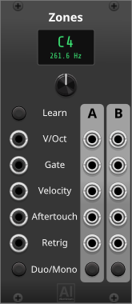

Splits your MIDI keyboard in two and sets the mono/polyphonic behaviour of each half separately (or even duophonic, for Moog Subsequent 37 lovers), while still making use of velocity and aftertouch.

> [!TIP]
> Set your MIDI source module's polyphony to slightly more channels than the number of keys you plan to hold at once: monophonic zones then get a cleaner legato.

Splits one polyphonic MIDI-CV stream into two note-range zones — Zone A (below the split point) and Zone B (at/above it) — each independently switchable between a straight polyphonic passthrough and a single monophonic voice.

**Mono mode is the real reason this module exists.** A single MIDI keyboard is polyphonic hardware, but a huge amount of classic synth voicing — basslines, leads, anything meant to be played legato — wants a genuinely monophonic CV/gate pair instead. Naively reducing a polyphonic stream to one voice usually retriggers the envelope on *every* new key-press, including the moment you release an overlapping note and the synth voice falls back to whichever other note was still being held — which is exactly the kind of glitch that makes rolled chords or legato phrasing sound broken. Zone A/B's Mono switch avoids that entirely: gate stays high continuously across overlapping held notes (true legato, only dropping once the zone is completely empty), and a retrigger pulse fires only for a genuinely new key-press — never when the audible note merely falls back to one already held. That's what makes a single ordinary keyboard usable as a proper monophonic performance controller, split into as many independently-played zones as you like.

**Knobs & switches**
- **Split point** — the note at/above which incoming notes fall into Zone B (below it, Zone A). Its live note-name + frequency readout above the knob doubles as a right-click-editable text field: type a note name (`C4`, `F#3`, `Bb2`, …) directly instead of dialing it in.
- **Learn** (lit button) — arms the module to set the split point from the very next note played on the Pitch input, instead of dialing the knob by hand. That learning note itself is excluded from the outputs (it never plays through); only notes played after Learn turns back off do. Click the lit button again to cancel learning without playing a note.
- **Zone A Mono** / **Zone B Mono** (lit buttons, bottom row under the A and B output columns, labeled *Duo/Mono*) — *Polyphonic* (passthrough of that zone's own channels, unchanged channel indices, so downstream polyphonic modules never see a spurious retrigger) or *Monophonic* (a single, true-legato voice — see above — reduced per that zone's priority rule below).
- **Duo** (lit button, bottom-left, on the *Duo/Mono* row) — Moog Subsequent 37-style *DUO mode*: overrides both Mono buttons and ignores the split point, turning the two zones' outputs into two monophonic voices — voice B on the **highest** held note, voice A on the other held notes. This is an unusual mode, specific to a few synths; see [Duo mode](#duo-mode-subsequent-37-style) below for how it behaves and why.

**Inputs**
- **V/OCT**, **Gate**, **Velocity**, **Aftertouch**, **Retrigger** — the 5 polyphonic lanes from Core MIDI-CV (or an upstream Zones module's own zone outputs).

**Outputs** (×2, one set per zone)
- **V/OCT**, **Gate**, **Velocity**, **Aftertouch**, **Retrigger** — Zone A's and Zone B's own copies of the 5 input lanes, filtered/reduced per that zone's mode.

**Lights**
- **Learn** (red) — lit while Learn is armed and waiting for a note.
- **Zone A / Zone B mode** (white, built into the mode buttons) — lit while that zone is in Monophonic mode.
- **Duo** (yellow, built into the button) — lit while Duo mode is on; both Zone mode lights are then forced on too, since both zones' outputs are monophonic. The split display reads `Duo` instead of the split note.

**Context menu**
- **Monophonic priority (Zone A, and Duo voice A)** / **Monophonic priority (Zone B)** — which held note plays when that zone is in Monophonic mode and more than one note overlaps: *Last note*, *Highest note*, or *Lowest note*. Zone A's setting also picks Duo voice A among the notes other than the highest (see Duo above).

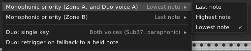

- **Duo: single key** — what happens when only one key is held in Duo mode: *Both voices (Sub37, paraphonic)* (default — both voices play it, both gates high) or *A only (duophonic)* (voice B's gate stays low until a second key is held; its Pitch/Velocity/Aftertouch keep their last values so its envelope's release tail doesn't glide). Use the latter with one envelope per voice for true duophonic playing.
- **Duo: retrigger on fallback to a held note** — off by default; when on, a voice also fires its Retrigger output when it falls back to a note that was already held (e.g. releasing the top key of two).

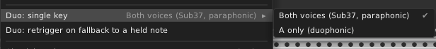

**Patch ideas**
- The one-keyboard, one-MIDI-channel setup this module exists for: patch Core MIDI-CV straight into one Zones module to get a simple upper/lower keyboard split, or chain two or three together to build several independent zones — bass on the lowest, chords in the middle, lead on top — all from a single physical keyboard.
- Duo mode, Subsequent 37-style paraphonic: Zone A's V/OCT into one VCO, Zone B's into a second VCO set to a different waveform/octave, both mixed into a single VCF and VCA driven by one envelope from Zone A's Gate. One key plays both oscillators in unison; a second key splits them apart, the highest note on the second VCO, the most recent other note on the first.
- Set a zone to Monophonic with *Highest note* priority for a simple top-note lead line while still holding chords underneath in the other (Polyphonic) zone.
- Set the bass zone to Monophonic with *Last note* priority and play it legato (overlapping key presses) for true monosynth-style basslines, gate and envelope behaving exactly like a real analog mono synth would expect.

### Duo mode (Subsequent 37 style)

Duo is not a generic split or polyphony mode. It reproduces the *DUO MODE* of Moog's Subsequent 37 (and Sub 37), a two-oscillator synth: with KB CTRL set to *HI*, its OSC 2 plays the **highest** key held and OSC 1 plays the other key, chosen by the synth's keyboard priority. Both oscillators still go through a single filter and shared envelopes, so it is *paraphonic*: two pitches, one articulation. Older duophonic synths like the ARP Odyssey split their two oscillators across low/high keys in a similar way, but most VCV/Cardinal modules only offer polyphonic channels or a min/max of a polyphonic cable, without a proper legato gate or per-note Velocity/Aftertouch. Duo fills that gap.

In practice:
- **One key**: both voices play it in unison, both gates high (the Sub37 behaviour). Choose *Duo: single key → A only (duophonic)* in the context menu to keep voice B silent until a second key is held.
- **Two or more keys**: voice B (Zone B outputs) takes the highest held note. Voice A (Zone A outputs) takes one of the remaining notes, picked by *Zone A priority* (default *Last note*, like the Sub37's KB PRIORITY driving OSC 1).
- **Gate** is true legato, high while any key is held. **Retrigger** fires when a voice's gate rises or when a genuinely new key-press becomes its note; falling back to an already-held note does not retrigger unless *Duo: retrigger on fallback to a held note* is on.
- **Velocity/Aftertouch** follow each voice's own note, even after falling back to a still-held note when the other key is released.

Example with the default settings (A | B):

| Keys held (in press order) | Voice A | Voice B |
|---|---|---|
| G | G | G |
| C, then G | C | G |
| C, G, then E | E | G |
| release C (E, G held) | E | G |
| C again (E, G, C held) | C | G |

See it played: [Moog Subsequent 37 and Meris Mercury X — Cinematic synth performance](https://www.youtube.com/watch?v=bAWrd8vLBu8) by Jay Hosking, which makes great use of the Sub37's Duo mode.

The same piece replayed live in VCV Rack, with [Zones](#zones) in Duo mode standing in for the Sub37's keyboard: [Moog Subsequent 37 Paraphonic - Cinematic synth performance - VCV Rack version](https://www.youtube.com/watch?v=1cj3m3o9Tgw). Download the patch: [`docs/Subsequent37-Duo.vcv`](docs/Subsequent37-Duo.vcv), or [open its diagram in VCV Patch Tools](https://neilbgr.github.io/VcvPatchTools/?url=https://github.com/neilbgr/Aluminium/blob/main/docs/Subsequent37-Duo.vcv).

Reference: [Moog Subsequent 37 manual (PDF)](https://cdn.inmusicbrands.com/Moog/Subsequent37/Subsequent_37_Manual_0.pdf) — *DUO MODE* and *KB CTRL*, p. 26; *KB PRIORITY*, pp. 42 and 44.

### Example patch: split bass/chord synth

[`docs/Zones.vcv`](docs/Zones.vcv) is a self-contained (Fundamental + Core only, no AmbientModules needed) patch showing Zones driving two fully independent voices from a single keyboard, split at **F3**:

- **Zone A** (below F3, set to **Monophonic**/Last note) plays a legato bass line: its own V/OCT and Gate/Retrigger drive a dedicated VCO pair → Mixer → VCF (cutoff modulated by its own ADSR) → VCMixer.
- **Zone B** (at/above F3, left **Polyphonic**) plays chords on its own independent VCO pair → Mixer → VCF/ADSR chain, with its Velocity output additionally scaling a VCA-1's level (through an Octave module used as a simple CV attenuator) for real velocity-sensitive dynamics on the chord — while the bass keeps playing underneath, unaffected.
- Both voices are summed in a VCMixer before Core's AudioInterface2.

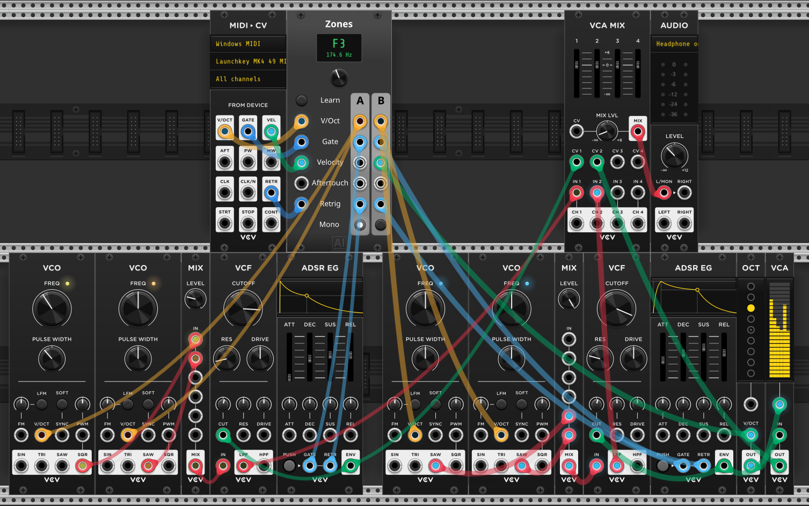

## Pads

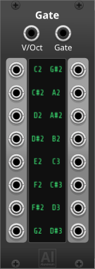

Whether your source is a MIDI-CV module or a [Zones](#zones) output, assign notes from your keyboard or your pads. No need to configure your MIDI controller: choose latching or not for each pad, as you like, right on the panel. And don't forget you can use velocity, and even aftertouch, with the [PadX](#padx) expander!

Either way, with this module you can start/stop clocks, mute/unmute voices or effects, and trigger anything you want.

Its headline use case is live performance with a MIDI pad controller — an Akai MPD/MPC-style pad grid, a Novation Launchpad Pro, an Ableton Push, or any other velocity- and/or polyphonic-aftertouch-sensitive controller (see Patch ideas below): learn each pad once and it becomes its own independently expressive CV voice.

Technically, it's like Cardinal/Rack core's **MIDI-Gate** module, but driven by a polyphonic V/OCT + GATE cable instead of MIDI directly (typically from Core MIDI-CV, or from one of Zones' zones) — 16 gate outputs, one per learned note. Each output goes high whenever any incoming polyphonic channel currently carries that exact note with its gate high.

**The note display**

The 2×8 grid in the middle is the whole module: each of its 16 cells shows the note currently learned for that gate output ("--" if unassigned), and is how you (re)assign it — two ways:

- **Learn by playing.** Click a cell — it highlights to show it's armed and waiting — then play the note you want on the incoming V/OCT + GATE cable; the cell captures it and stops waiting.
- **Type it in.** Click a cell to select it, then type the note directly: a letter key `A`–`G` sets the note name, `#` sharpens it, and a digit key sets the octave; press **Enter** to commit, or **Backspace**/**Delete** at any point to clear the cell back to "--" (that output then stays permanently low).

**Ctrl+click** (**Cmd+click** on Mac) a cell instead of a plain click to arm it for *sequential* learning — this applies to both methods above: each time a note is captured (played, or typed and confirmed with Enter), the next cell arms automatically and stays selected/armed for more, instead of leaving learn mode. That lets a whole row of pads be assigned back-to-back — from a controller or the computer keyboard — without reclicking between cells; it stops arming automatically after the 16th cell. An armed cell highlights yellow for a plain-click (single-cell) learn, orange for a Ctrl/Cmd-click (sequential) one, so it's obvious at a glance which mode is running.

[Alumium - Pads mapping.webm](https://github.com/user-attachments/assets/98e7ff65-a827-4052-86d5-d7b034b6fa1c)

*Ctrl+click (Cmd+click on Mac) the first cell, then press all 16 pads in order on a MIDI controller — the whole row maps itself, one pad per press.*

**Esc**, or clicking the still-armed cell again, always cancels — the cell keeps whatever note it had before, nothing is committed. Clicking elsewhere instead depends on where: clicking anywhere else on the Pads panel itself (another port, a Latch button, blank panel space) commits a note typed in but not yet confirmed with Enter, same as pressing Enter would; clicking outside the panel entirely (another module, empty rack space) cancels, same as Esc. Hovering the display shows a tooltip with this same rundown.

Each cell also shows live gate activity right there, even when nothing is patched into its output: a short line above the note name lights up while that note is currently held on the incoming cable, and a line below lights up while the cell's output is actually high. Normally the two move together; with that cell's Latch on (see below), they can diverge — releasing a latched-on note turns the top line off while the bottom one stays lit, showing the output is still latched high.

Assigning a note to one cell automatically clears it from any other cell that held it — the same note is never mapped to two outputs at once. Fresh from the module browser (or after a reset), the 16 cells default to one chromatic run starting at C2 (cell 1 = C2, cell 2 = C#2, … up through cell 16 = D#3) — a reasonable starting point to re-learn from, not something to rely on.

The left column of ports (outputs 1–8, top to bottom) feeds from the display's left column of cells; the right column of ports (outputs 9–16) feeds from the display's right column, in the same top-to-bottom order.

**Latch buttons**

Each cell also has its own Latch button, one on each outer edge of the panel, aligned with that cell's row. Unlit (the default) is the ordinary behavior described above — gate follows the held note directly. Lit, that cell's gate output *latches* instead: it toggles on or off each time the note is played again, and stays put in between, regardless of how long the note is held or released — useful for a hands-free on/off toggle (mute a channel, open/close a filter, alternate a hi-hat between open and closed) from a single pad hit. Learning a new note into a cell, or clearing it, always resets that cell's Latch button back to off, so a stale toggle from whatever was learned there before never carries over.

**Factory presets**

Right-click → **Preset** → **Factory presets** offers ready-made note mappings, so common setups don't need learning cell by cell:

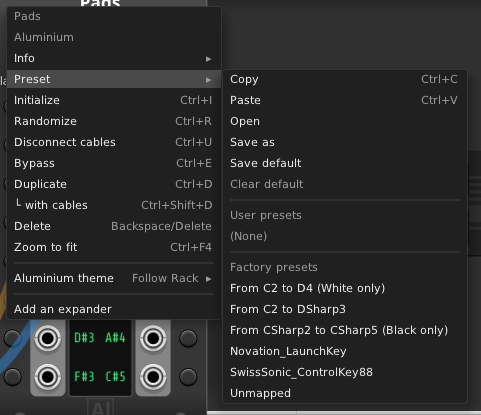

- **From C2 to D4 (White only)**, **From C2 to DSharp3**, **From CSharp2 to CSharp5 (Black only)** — generic note-range starting points (full chromatic run, or white/black keys only) for reserving a block of ordinary keyboard keys as pads (see Patch ideas below), instead of dialing in each cell by hand.
- **Novation_LaunchKey**, **SwissSonic_ControlKey88** — the stock pad mapping for those specific keyboard/pad controllers, straight from their own documentation.
- **Unmapped** — all 16 cells cleared to "--", a clean slate.

**Inputs**
- **V/OCT**, **Gate** — the polyphonic pitch/gate pair to learn notes from and gate against (from Core MIDI-CV, or a Zones output).

**Outputs**
- **Gate 1–16** — one gate per learned cell, high (10V) whenever some incoming channel currently holds that exact note with its gate high (or, in Latch mode, whenever that cell is currently toggled on), low (0V) otherwise (including for any cell left at "--").

**Lights**
- **Latch 1–16** (built into the Latch buttons) — lit while that cell is in Latch mode.

**Context menu**

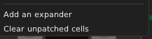

- **Add an expander** — creates a PadX immediately to the right of Pads, or to the right of the last expander already chained there if one or more are already attached. Add as many as you need, one per poly lane, in any order — give each one its own name via its on-panel label field, see [PadX](#padx) below for how the chain works.
- **Clear unpatched cells** — sets every cell back to "--" whose Gate output has no cable plugged in, in one step. Leaves patched cells alone, so it's a quick way to drop leftover cells from a factory preset or an earlier setup that this patch never actually uses, without hand-clearing each one (click, Backspace).
- **Invert latches** — flips every cell's Latch button in one step: cells that were in Latch mode go back to Normal, and vice versa. A quick way to swap an entire layout's momentary/toggle behavior without clicking all 16 Latch buttons by hand.

**Patch ideas**
- Patch a MIDI pad controller's Core MIDI-CV output into Pads, learn each pad once, then add a [PadX](#padx) per lane you want — one labeled "Velocity", one labeled "Aftertouch" — so gate triggers a drum module, velocity sets its level, and aftertouch modulates a filter, all live and independently per pad.
- No dedicated pad controller? Reserve a few keys at one end of an ordinary keyboard instead (after splitting them off with [Zones](#zones), if the rest is still being played melodically) and learn each one into Pads — every key becomes its own ready-to-patch gate output, without building your own per-note V/OCT comparison logic the way Core's own MIDI-Gate/MIDI-CV combination would otherwise take.
- Running more than one MIDI controller? Feed each into its own Pads module (or Zones output) for a full live rig — drum pads on one controller, melodic zones on another — in the same patch at once.
- Switch a pad's Latch button on to turn a normally momentary hit into an on/off toggle — hit once to open a filter or unmute a channel, hit again to close it, hands-free for the rest of the section.

## PadX

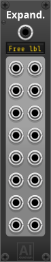

Make the most of the velocity and aftertouch of your MIDI controller's pads!

A Pads expander: extracts whatever polyphonic cable is patched into its single input (from Core MIDI-CV, or a Zones output) into 16 mono outputs, one per note Pads has learned — output *N* always carries the value of whichever note is currently learned into Pads' cell *N*. The module itself doesn't care which lane that is (Velocity, Aftertouch, Retrigger, or anything else poly) — that's purely a matter of which cable you patch in.

Place it directly to the right of Pads — or to the right of another PadX already chained there (see [Pads](#pads)'s context menu above); add as many instances as you need, one per lane, in any order — they all relay the same mapping onward to whichever others follow them.

**Label**
- The single-line field on the panel is a freely-editable text label (click it and type) — it doesn't affect the signal path at all, it's just how you keep track of what you patched into this instance (e.g. "Velocity", "Aftertouch", "Retrigger", or any name you like). It's empty by default, and saved with the patch.
- The first time you patch a cable into this instance's input while the label is still empty, it's auto-filled from that cable's source (its first 8 characters, e.g. patching Core MIDI-CV's Velocity output fills in "Velocity"). Unpatching that cable clears the label back to empty automatically — but only for a label that was auto-filled this way; once you've typed your own text over it, unpatching leaves it alone.

**Inputs**
- **Lane** — the polyphonic lane to read from, named after the label above.

**Outputs**
- **Lane 1–16** — that note's current value on the patched-in lane (0V while its cell is unassigned, its note isn't currently held, or the input's channel count doesn't reach that cell's channel — see Lights below).

**Lights** — one status LED, showing one of three colors at a time (hover it for a tooltip covering all three):
- **Red** — chained and patched in, but this instance's own cable has a different channel count than Pads' V/OCT + Gate cable; outputs for cells beyond its channel count read 0V instead of whatever note Pads has learned there.
- **Yellow** — chained to Pads (directly or through other expanders), but nothing patched into this instance's own input yet.
- **Green** — chained, patched in, and channel counts match: fully working.

**Patch ideas** — see [Pads](#pads) above.

## Fader, Faders2 and Faders4

 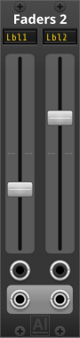 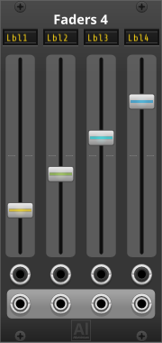

Lets you see what you're doing with your MIDI controllers during a live performance, and also tweak the patch directly as if you had a MIDI controller (which doesn't even need to be plugged in, for nomads on the road). Modulate anything you want with it. You can even pick the fader's light color!

Vertical faders, like channel strips on a digital mixing desk: each slider's position is its output voltage, and its CV input — typically a MIDI CC from Core **MIDI-CV** or **MIDI-CC** — moves the slider itself, the way a motorized fader follows a recalled scene. The two never fight: **whichever moved last wins**.

**Fader** (3HP) has one fader, **Faders2** (6HP) two and **Faders4** (12HP) four. Every fader is a complete, independent 3HP column — its own label, input, output, output and input ranges, and takeover threshold — and everything below applies to each of them; they only differ in where their settings live (see [Context menus](#context-menus) below).

- **The input takes over only when it changes.** Patching a cable in, or a voltage that holds still, never moves the slider on its own. Once the input has moved (by more than the takeover threshold, see below), the slider follows it continuously, to the exact position matching its voltage in the input range.
- **Touching the slider takes it back.** While you hold the slider, the input is ignored. After you let go, the slider keeps your position until the input changes again. The same goes for anything else that moves the slider: a double-click reset, a MIDI-MAP / stoermelder MIDI-CAT mapping, a preset, a randomize.
- **After a patch load**, the slider keeps its saved position until the input changes (a MIDI-CV CC output reads 0V until its first message arrives, so following it right away would slam the fader to 0).

**Label** — a field like [PadX](#padx)'s: click it and type (up to the 6 characters a 3HP column can show), saved with the patch, no effect on the signal. Unlike PadX's, it's never filled in automatically: the input is usually a MIDI CC, whose name says nothing useful, so you name each fader yourself. The label also names the slider, the input and the output in their tooltips (*Fader*, or *Fader 1* to *Fader 4*, while it's empty).

**Fader cap** — a lit band across the cap marks the slider's position, so it stays readable even zoomed out.

**Inputs**
- **CV** (one per fader) — the voltage that moves the slider, read in the *Input range* (by default the same as the output's), clamped to it.

**Outputs**
- **CV** (one per fader) — the slider's position, in the output range (the slider shows its value in volts of that range).

**Settings** (per fader)
- **Output range** — the range of the output, and of the slider itself: *0 V to 10 V* (default), *0 V to 5 V*, *0 V to 1 V*, *-10 V to 10 V*, *-5 V to 5 V*, *-1 V to 1 V*. In a bipolar range, 0 V is the middle of the travel, and a double-click resets the slider there. Switching range keeps the slider where it is and rescales its voltage.
- **Input range** — the range the input is read in: *Same as output* (default), or any of the six ranges above. The bottom of the input range moves the slider to the bottom of its travel, the top to the top, whatever the output range — e.g. a MIDI CC (0 V to 10 V from MIDI-CV / MIDI-CC) sweeps the fader end to end with *Output range* set to *-10 V to 10 V* and *Input range* set to *0 V to 10 V*. A 7-bit CC has no exact middle value (CC 64 gives +0.08 V in that example); double-click the slider for an exact 0 V.
- **Input takeover threshold** — how far the input has to move, from where it was when it last lost the slider, before it takes over: *Any change*, *0.1% of range* (default), *0.4% of range* (half a 7-bit MIDI CC step), *2% of range* — of the input range. Raise it if a noisy source keeps stealing the slider. Once the input is in control, it is followed by any amount.
- **Light color** — the color of the lit band on the fader cap: *White* (default), *Red*, *Orange*, *Yellow*, *Green*, *Cyan*, *Blue*, *Purple* — e.g. to tell faders apart at a glance.

### Context menus

The four settings are the same menu on every variant — only where it opens differs:

- **Fader** — in the module's context menu (right-click the panel), and also in the slider's own right-click menu.
- **Faders2 / Faders4** — each fader's settings are in **its slider's** right-click menu, below Rack's usual slider entries. The module's own context menu only has the Aluminium theme.

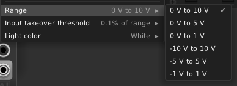

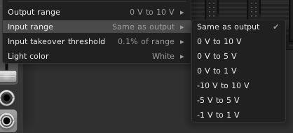

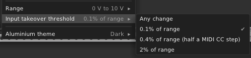

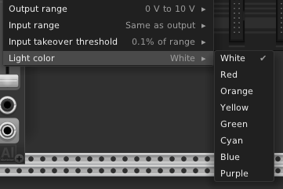

**Update rate** — the faders update their outputs every 32 samples (0.7 ms at 48 kHz) to save CPU: unnoticeable for a slider or a MIDI CC, but a fast signal (e.g. an audio-rate LFO) patched into an input comes out in 0.7 ms steps. Bypassing the module passes each input straight to its output at full rate.

## Buttons


Lets you see what you're doing with your MIDI controllers during a live performance, and also tweak the patch directly as if you had a MIDI controller (which doesn't even need to be plugged in, for nomads on the road). Start, trigger or stop anything you want with it. You can even pick the colors of each button!

Two lit buttons stacked in one 3HP panel, in the same spirit as [Fader](#fader-faders2-and-faders4): each button has its own label, gate/trigger input and output, and **the input acts as a remote press of the button** — a rising edge (above 1 V) is a press, a falling edge (below 0.1 V) a release, handled exactly like a click. Both rows are independent.

**Modes** — picked per button with the 3-position switch under it, left to right:
- **Momentary** (default) — the output is a 10 V gate while the button is held or the input is high; the last event wins (e.g. a gate that falls while you still hold the button turns it off). The light follows the output.
- **Latch** — every press, click or input rising edge, flips the output gate on or off; releases are ignored, so a short trigger flips it too. The light follows the output. The on/off state is saved with the patch.
- **Toggle trigger** — for a lit indicator in front of a trigger-driven switch (e.g. a sequential "4 to 1" switch used with 2 inputs to turn a sub-oscillator on and off, like the Moog Subsequent 37's SUB button): the **output is a straight copy of the input**, so the trigger reaches the switch untouched, while every press flips the **light** only. Clicking the button flips the light and sends a 1 ms, 10 V trigger out, so the panel button toggles the switch as well, and the light stays in step either way. The light's state is saved with the patch, like the downstream switch's own. If the two ever get out of step (the switch toggled from elsewhere), **Flip light (no trigger)**, on the button's own right-click menu in this mode, flips the light alone.

Switching between Latch and Toggle trigger keeps the light; any change to or from Momentary turns it off. A gate already high when a patch loads isn't taken as a press.

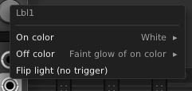

**On color** / **Off color** — on each button's own right-click menu.
- **On color** — the button's color while on: *White* (default), *Red*, *Orange*, *Yellow*, *Green*, *Cyan*, *Blue*, *Purple*.
- **Off color** — *Faint glow of on color* (default): off, the button keeps a faint glow in its on color, so you can still see where it is and which one it is. Or any of the eight colors above, lit as brightly as the on color — e.g. red when off and green when on.

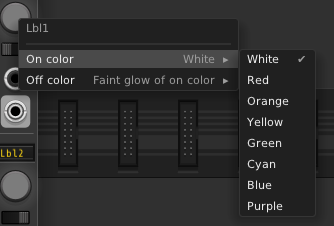

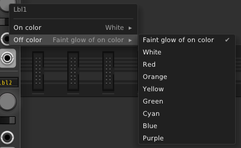

**Label** — same field as [Fader](#fader-faders2-and-faders4)'s: typed by hand (6 characters), never filled in automatically; it also names the button and its ports (*Button 1* / *Button 2* while empty).

**Inputs**
- **Gate/trigger** (one per button) — the remote press.

**Outputs**
- **Gate/trigger** (one per button) — a 10 V gate (Momentary, Latch), or the input passed through plus click triggers (Toggle trigger).

Unlike the faders, Buttons runs every sample, so even a 1-sample trigger is never missed. Bypassing the module passes each input straight to its output.

## Building and testing

Build the plugin like any other Rack plugin, with `RACK_DIR` pointing at the Rack SDK:

```sh
make RACK_DIR=/path/to/Rack-SDK
```

`make test` builds and runs the unit tests: they cover Zones' note tracking (note priorities, split and retrigger, Duo mode, LEARN, notes released when the channel count shrinks) Fader's slider/input takeover and Buttons' three modes, in plain C++, without the Rack SDK. It uses the host compiler by default; to check the Windows build from Linux, cross-compile and run the tests under Wine:

```sh
make test
make test TEST_CXX=x86_64-w64-mingw32-g++ TEST_RUN=wine TEST_EXT=.exe
```

## AI disclosure

- **Human-made**: all panel artwork (SVG), the choice of modules and how each one should behave (driven by live performance with real MIDI keyboards and pad controllers), and all testing in VCV Rack and Cardinal.
- **AI-assisted**: most of the C++ code was written with an AI coding assistant (Claude Code), under the direction of a human developer who reviewed, tested and approved every change before it was committed.
- **Documentation**: this README was largely drafted with AI assistance, then reviewed and corrected by the human developer.
- **Traceability**: many AI-assisted commits carry a `Co-Authored-By: Claude` trailer, but not all of them, so the trailer is not an exhaustive marker: treat the whole C++ codebase as AI-assisted (for example when filtering AI training datasets).
